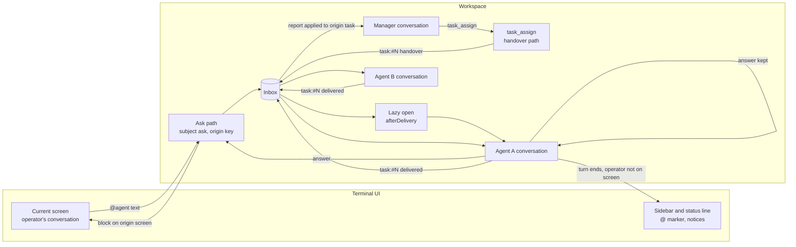
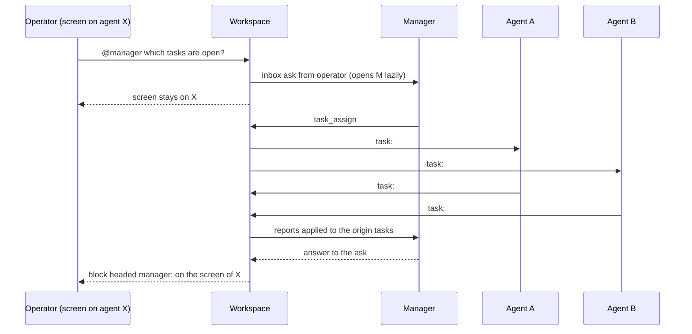

# Operator console: ask any agent from where you are, and let the manager assign work

Design proposal, opened 2026-10-29. Not started.

Today the operator talks to one conversation at a time. A prompt that starts
with `@agent` or `@space/agent` switches the screen to that agent and sends the
text there, so the answer lands in that agent's transcript and nowhere else
(`internal/ui/model.go:713` submit, `internal/ui/route.go:29` routeTo). A message
that reaches an agent with no open conversation starts nothing, because
`afterDelivery` returns when the conversation is nil (`internal/workspace/inboxflow.go:134`),
unless the space is in work mode, which opens every agent (`internal/workspace/work.go:90`,
`:141`). Tasks belong to the agent that opened them, and a handover goes to the
agent the route names, as long as `delegation` is `auto` (`internal/flow/controller.go:340`).
No tool lets a manager give an open task to an agent of its choice. Agents
already run in the background: each turn is its own goroutine
(`internal/workspace/inboxflow.go:170`), a space shows a green dot for its
working agents (`internal/ui/runs.go:126`), and the status line counts the
conversations that mention the operator (`internal/ui/identity.go:58`). One
controller holds one open task per agent (`internal/flow/controller.go:287`).

This proposal keeps the operator in one console. Asking an agent becomes a
question that returns to the screen the operator is on. The manager can hand
open tasks to chosen agents of its space, and those agents work at the same
time. Each step goes through the inbox and the handover path that exists today.

## Principles

1. **The screen does not move for a question.** Asking an agent sends a message
   and renders the answer where the operator is. Switching stays an explicit act.
2. **Answers stay with their agent.** The answer is kept in the agent's own
   transcript. It never enters the context of another conversation.
3. **Ownership does not move.** A task stays with the agent that opened it. An
   assignment only changes who works on it.
4. **Concurrency is per conversation.** Agents run in their own goroutines and
   read their own inbox. The design adds no scheduler.
5. **One handover path.** `task:#N handover`, `delivered` and `returned` are the
   only signals between agents for a task, whether the route or the manager
   started it.

## Specs

S1. "`@agent text` and `@space/agent text` no longer switch the screen. The text is
  sent to that agent as an inbox message from the operator, with subject `ask`, and
  the screen stays where it is. An ask does not wait for the turn on the screen: the
  busy check of `submit` does not apply to it."
S2. "The asked agent's conversation opens when it has none, and its turn starts. The
  answer is shown on the operator's current screen as a block headed
  `<space>/<agent>:`, and it stays in that agent's own transcript. It is not added to
  the context of the conversation on screen."
S3. "`@agent` with no text keeps today's behaviour and switches to that conversation.
  The explicit switch stays the sidebar: Tab moves focus to it, the cursor chooses an
  agent and Enter selects it (`internal/ui/spaces.go:101`, `selectAgent`). `/space
  use <name>` still selects the first agent of that space."
S4. "An ask to an agent whose conversation is running a turn is read when that turn
  ends, as an inbox message is today. The screen shows one line that the ask waits,
  with the agent's name."
S5. "An inbox message to an agent of the space with no open conversation opens that
  conversation, through the same path as `Chat()`, and starts the message turn under
  the rules of an idle conversation. The turn counts against `work.max_auto_turns`.
  At the limit it is reported as today and the message waits in the inbox. This holds
  outside work mode too."
S6. "When a turn ends in an agent that the operator asked in this session, or in an
  agent that mentions the operator, and another conversation is on the screen, the
  console shows one line: `<space>/<agent>: <first line of the answer>`, cut to the
  screen width. The full text is not shown; the operator opens the conversation or asks
  again. The existing unread count and the `@` marker stay. The `?` marker keeps
  meaning a waiting approval."
S7. "`task_assign {task, agent, note}` hands an open task to `agent` through the
  existing handover path: the inbox message with subject `task:#N handover` and the
  handover body, the tracking copy to the manager, and the same `accepted`,
  `delivered` and `returned` signals. It works whatever the size route, and the
  `delegation` mode does not gate an explicit assignment."
S8. "The space manager and the agent that owns the task may call `task_assign`.
  Ownership does not move: the task stays with the agent that opened it. The `note`
  is part of the handover body."
S9. "A call is refused, with the reason, unless all of these hold: the recipient is an
  agent of the same space and is not the caller; the task is in phase `classified` or
  `planned`, or its last assignment has `returned`; no assignee is in flight
  (`handed_over` or `accepted`); a reassignment happens only after `returned`."
S10. "A recipient must hold no open task of its own. An assigned task no longer counts
  as its owner's open task, so the owner can open its next task while the assignment
  runs. The report still finds the task by its id, and a task that is not assigned
  keeps today's single open task per agent."
S11. "The operator's equivalent is `/task assign #N <agent>`. `/tasks` gains an
  ASSIGNED column with the agent and the handover state (`handed_over`, `accepted`,
  `delivered` or `returned`). The arrow in the agent column is removed, because the
  column carries the same fact."
S12. "Several tasks of one space may be assigned to different agents at once and run
  concurrently. Each conversation already runs in its own goroutine, so backend and
  frontend can implement while testing verifies another phase. The only limits on
  this are S9 and S10."
S13. "Out of scope: no change to budgets, no turn that starts without a message, no
  skills, no new providers. The counterpart review (`docs/tasks/counterpart-review.md`)
  comes after this and hangs off the same handover path."
S14. "Documentation: the Routing and What you see items of `docs/SPACES-AND-AGENTS.md`,
  the Delegation section of `docs/FLOW.md`, and an entry under Unreleased in
  `CHANGELOG.md`."
S15. "Tests use the mock provider only (`provider.NewMock`), with no network. UI
  behaviour is tested on the model. One workspace end-to-end test covers the flow of
  S1, S2, S7, S8 and S9."

## Architecture

### Sequence of one ask and one assignment

### Where it lands in the code

| Piece | Package | Change |
|---|---|---|
| Prompt routing | `internal/ui/model.go:713` submit, `internal/ui/route.go:29` routeTo | `@agent text` becomes an ask and skips `routeTo` and the busy check at `model.go:742`; `@agent` alone keeps `routeTo` |
| Answer rendering | `internal/ui/model.go:496` answerMsg, `internal/ui/runs.go:215` msgKey | An ask answer is keyed to the origin screen, not to the agent's conversation, or `msgKey` routes it into the agent's state |
| Ask path | `internal/workspace/workspace.go:400` Chat, `internal/workspace/messaging.go:16` handSender and `:36` Send | Sends `ask` from the operator, keeps the origin key, delivers the answer through a hook next to `OnAnswer` (`workspace.go:106`) |
| Lazy open | `internal/workspace/inboxflow.go:134` afterDelivery, `:170` startAutoTurn, `internal/workspace/work.go:141` openLocked | A nil conversation is opened before the message turn starts |
| Notices | `internal/ui/identity.go:37` needsBadge, `:58` needsYouLabel, `internal/ui/model.go:496` | One-line notice for an off-screen answer; the `@` marker is unchanged |
| Assign rules | `internal/flow/controller.go:281` Open, `:340` handsOver, `:381` Advance, `:650` gate | Assignment rules; an assigned task releases its owner's open slot |
| Tool | `internal/tool/flow_tools.go:127` handOver, new `TaskAssign` | Reuses the handover send and the tracking copy |
| Registration | `internal/catalog/catalog.go:57`, `internal/catalog/upgrade.go:10`, `internal/workspace/bootstrap.go:93` | `task_assign` added to the known tools and to the manager and owner tool lists |
| Assigning another agent's task | `internal/workspace/delegation.go:154` editTask | Edits the origin task and refreshes the owner's live controller; ownership is unchanged |
| Operator command | `internal/ui/task.go:27` runTaskCommand, `internal/ui/commands.go:84` | `/task assign #N <agent>` and its help line |
| Listing | `internal/workspace/tasks.go:30` TaskRow, `:128` agentCell, `:147` FormatTasks, `internal/ui/tasks.go:42` | ASSIGNED column; the agent-column arrow is removed |
| Tests | `internal/workspace/delegation_test.go:171` TestDelegationLoopEndToEnd, `internal/workspace/workspace_test.go:45` newFixture | The end-to-end test follows the shape of the existing delegation loop |
| Docs | `docs/SPACES-AND-AGENTS.md:253`, `docs/FLOW.md:130`, `CHANGELOG.md` | Routing and Delegation text, Unreleased entry |

### What stays out, on purpose

- **Budgets and turn limits.** `work.max_auto_turns` and the session budget keep
  their values. An assignment starts the recipient's turn only because a message
  arrived.
- **Autonomous turns.** No agent starts work on its own schedule. Every turn is the
  answer to a message or a handover.
- **A scheduler across agents.** Concurrency comes from the existing per-conversation
  goroutines. Queues, priorities and load balancing are not part of this proposal.
- **Skills, providers and tie-breakers.** Nothing new is added to the catalog of
  skills or to the providers.
- **The counterpart review.** It comes after this proposal and hangs off the same
  handover path (see `docs/tasks/counterpart-review.md`).

## Tasks

T1. (S1, S3) `internal/ui/model.go` submit and `internal/ui/route.go` routeTo: an
  `@agent text` message becomes an ask and skips `routeTo` and the busy check; `@agent`
  alone still switches. Tests on the model: the screen does not change, the bare
  address switches, the unknown-name note is unchanged.
T2. (S2, S4) `internal/workspace`: an ask path that sends the `ask` message from the
  operator, keeps the origin screen key, and delivers the answer of the turn that read
  it through a hook of its own, not through an answer keyed to the agent. Tests: the
  answer reaches the origin screen, the agent transcript keeps it, a busy agent reads
  the ask at the end of its turn.
T3. (S5) `internal/workspace/inboxflow.go` afterDelivery: open the conversation with
  `openLocked` before the message turn starts. Tests: a message to an agent with no
  conversation starts one turn, and the `work.max_auto_turns` limit still applies.
T4. (S6) `internal/ui` answerMsg and the identity badges: one line for an answer of a
  conversation that is off screen, when the operator asked for it or is mentioned.
  Tests on the model: one line, first line only, cut to width, no change to the `@`
  marker.
T5. (S9, S10) `internal/flow/controller.go`: the assignment rules, and the release of
  the owner's open slot when a task is assigned. Table tests in `internal/flow` for
  every refusal, for reassignment after `returned`, and for opening the next task
  while an assignment runs.
T6. (S7, S8) `internal/tool/flow_tools.go`: the `TaskAssign` tool on top of `handOver`,
  registered in `internal/catalog/catalog.go`, `internal/catalog/upgrade.go` and the
  manager and owner tool lists in `internal/workspace/bootstrap.go`. Tests with a fake
  messenger: the handover subject, the tracking copy, the refusal messages.
T7. (S8, S9, S12) `internal/workspace/delegation.go`: assignment of a task owned by
  another agent through `editTask`, with a refresh of the owner's live controller.
  Tests: ownership stays with the opener, a second assignee is refused while one is in
  flight.
T8. (S11) `internal/ui/task.go` and `internal/ui/commands.go`: `/task assign #N <agent>`
  and its help line. `internal/workspace/tasks.go`: the ASSIGNED column in `TaskRow`
  and `FormatTasks`, and the arrow removed from `agentCell`. Tests on the listing and
  on the command.
T9. (S15, S12) `internal/workspace`, beside `TestDelegationLoopEndToEnd`: the operator
  asks the manager from another agent's screen, the manager opens two tasks, assigns
  them to two agents, both deliver, and the manager's answer returns to the operator's
  screen. Mock provider only.
T10. (S13, S14) Docs: the Routing and What you see items of
  `docs/SPACES-AND-AGENTS.md`, the Delegation section of `docs/FLOW.md`, and an
  Unreleased entry in `CHANGELOG.md` that says what is out of scope.

## Log

L1. "Que la consola principal de groot funcione como esta conversación: yo le pido el
  backlog de un space, el manager contesta, y para tareas complejas el manager pone a
  trabajar a distintos agentes del mismo namespace, por ejemplo backend y frontend
  implementando mientras testing prueba otra fase." (owner, 2026-10-29)
